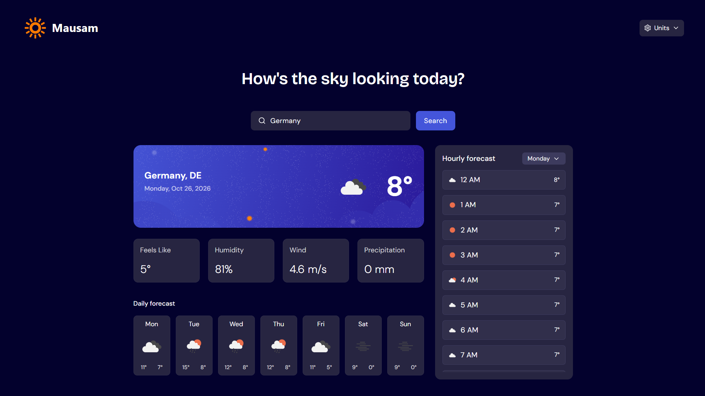
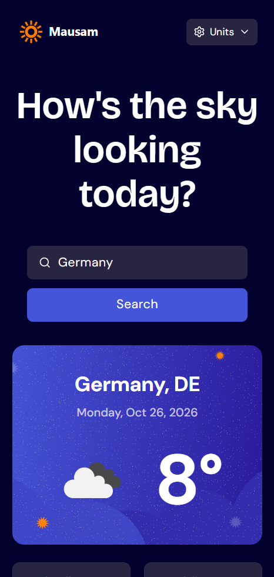

# Mausam




A responsive weather app built with React, Vite, and Tailwind CSS. Search for any city and see its current conditions and forecast.

> **Status:** Phase 3 (polish) and Phase 4 (deployment) complete — live on Vercel. Phase 5 (serverless proxy to hide the API key) is in progress. See the [Roadmap](#roadmap).

## Features (v0.4.0)

- Search for weather by city name
- Current conditions: temperature, weather icon, description, location, and date
- Metric tiles: feels-like temperature, humidity, wind speed, precipitation
- 7-day daily forecast with icon and high/low temperature per day
- Hourly forecast with a custom day-selector dropdown
- Imperial/Metric unit toggle, styled as a dropdown, with instant client-side conversion (no refetch)
- Loading skeleton for first-time searches, with a non-blocking "search in progress" indicator for subsequent searches
- Distinct error states: a friendly "No search result found!" for an unknown city, and a full-page error view with Retry for genuine API/network failures
- Hover and focus states across every interactive element
- Fully responsive layout across mobile, tablet, and desktop
- Dark UI styled with Tailwind CSS, using exact design-system color tokens

## Tech Stack

| Layer | Choice |
|---|---|
| UI | React |
| Build tool | Vite |
| Styling | Tailwind CSS (v4, custom `@theme` color tokens) |
| Icons | lucide-react |
| Current weather | OpenWeatherMap Current Weather API (via a Vercel serverless proxy) |
| Forecast data | Open-Meteo Forecast API |
| Hosting | Vercel |

## Getting Started

### Prerequisites

- Node.js 18+
- A free [OpenWeatherMap API key](https://openweathermap.org/api) (new keys can take up to a couple of hours to activate). Open-Meteo's forecast endpoint needs no key.
- [Vercel CLI](https://vercel.com/docs/cli) (`npm i -g vercel`) if you want to run the serverless proxy locally.

### Installation

```bash
git clone https://github.com/akantdotgit/mausam.git
cd mausam
npm install
```

### Environment variables

Copy the example file and add your key:

```bash
cp .env.example .env
```

```
WEATHER_API_KEY=your_api_key_here
```

> The key is read server-side only, inside `api/weather.js` via `process.env.WEATHER_API_KEY` — it is never prefixed with `VITE_`, so Vite never inlines it into the client bundle. `.env` is git-ignored. See [Architecture notes](#architecture-notes).

### Run locally

Plain `npm run dev` runs the Vite dev server, but it does **not** execute `api/` serverless functions, so weather search won't work. To run the full app (frontend + proxy) locally:

```bash
vercel dev
```

### Build for production

```bash
npm run build
npm run preview
```

## Deployment

Mausam is deployed on [Vercel](https://mausam-zeta-six.vercel.app/), connected directly to this GitHub repo:

1. Import the `mausam` repo into Vercel (auto-detected as a Vite project — build command `npm run build`, output directory `dist`).
2. Add `WEATHER_API_KEY` as an environment variable in the Vercel project settings (Production, and Preview/Development if desired).
3. Push to `main` to trigger a deploy, or deploy manually from the Vercel dashboard.
4. Verify search, forecast, unit toggle, and both error states on the live URL — not just `npm run preview`.

> Note: OpenWeatherMap does not offer HTTP referrer/domain restrictions on API keys (unlike some other providers), so the real protection here is the serverless proxy below, not a dashboard setting.

## Project Structure

```
api/
└── weather.js                   # Vercel serverless function — proxies OpenWeatherMap, hides the key
src/
├── components/
│   ├── SearchBar.jsx
│   ├── CurrentWeatherCard.jsx
│   ├── MetricsGrid.jsx
│   ├── DailyForecast.jsx
│   ├── HourlyForecast.jsx       # includes custom DaySelector dropdown
│   ├── UnitToggle.jsx           # custom dropdown: Metric/Imperial
│   ├── APIerror.jsx             # full-page error state with Retry
│   ├── LoadingState.jsx         # skeleton layout for first-time loads
│   └── Skeleton.jsx             # reusable pulsing placeholder block
├── hooks/
│   └── useWeather.js            # fetch state machine: idle | loading | success | error
├── services/
│   └── weatherApi.js            # all API calls + response normalization
├── utils/
│   ├── weatherCodeMap.js        # maps Open-Meteo WMO codes to OpenWeatherMap icons
│   └── unitConversion.js        # pure conversion + display formatting functions
├── App.jsx
├── index.css                    # Tailwind import + @theme design tokens
└── main.jsx
```

## Architecture Notes

- **Service layer** (`services/weatherApi.js`): the only frontend file that knows about the weather endpoints. `fetchCurrentWeather` calls the app's own `/api/weather` route (not OpenWeatherMap directly) and returns a normalized object (`{ name, country, lat, lon, current: {...} }`); `fetchForecast` calls Open-Meteo directly, since that endpoint needs no key, and returns `{ daily, hourly }`. Both calls always fetch in metric.
- **Serverless proxy** (`api/weather.js`): a Vercel serverless function that receives `?q=<city>` from the frontend, attaches the real OpenWeatherMap key server-side via `process.env.WEATHER_API_KEY`, calls OpenWeatherMap itself, and forwards the response back. This keeps the key out of the client bundle entirely — it never reaches the browser, unlike the original direct-fetch approach.
- **Coordinate reuse**: `fetchCurrentWeather` returns `lat`/`lon` from OpenWeatherMap's response (via the proxy), which `fetchForecast` consumes directly. This avoids a second geocoding call when fetching the forecast.
- **Custom hook** (`hooks/useWeather.js`): owns fetch state as a single `status` value (`idle | loading | success | error`) covering both the current-weather and forecast requests together, rather than tracking them independently.
- **Client-side unit conversion**: `units` is a display-only setting. Toggling it never refetches — `utils/unitConversion.js` converts and formats the already-fetched metric values on the fly, avoiding extra API calls and any toggle-triggered loading state.
- **Two distinct error states**: a city-not-found result is treated as a normal, friendly empty state ("No search result found!"), while any other failure (API error, network failure) renders a dedicated full-page `APIerror` component with a Retry action, driven by the error message rather than one generic catch-all.
- **Icon consistency**: Open-Meteo returns WMO weather codes, not icons. `utils/weatherCodeMap.js` maps each WMO code to an OpenWeatherMap icon, so current-weather, daily, and hourly icons all share one visual style.
- **Design tokens**: colors are defined once in `index.css` via Tailwind v4's `@theme` block, using the exact HSL values from the project's style guide, rather than scattering approximate built-in Tailwind colors across components.
- **One-way data flow**: `App.jsx` reads from the hook and passes data down to presentational components as props.

## Roadmap

- [x] **Phase 1:** search + current weather + metric tiles
- [x] **Phase 2:** 7-day forecast and hourly forecast with day selector
- [x] **Phase 3:** polish
  - [x] Imperial/Metric unit toggle
  - [x] UI states (loading skeleton, search-in-progress, API error with Retry, no-results)
  - [x] Hover and focus states
  - [x] Design system color tokens
  - [x] Responsive layout (mobile, tablet, and desktop)
- [x] **Phase 4:** deployment
  - [x] Deploy to Vercel
  - [x] Add API key as an environment variable
  - [x] Verify production build (search, forecast, units, error states)
- [ ] **Phase 5:** serverless API proxy to stop exposing the API key client-side
  - [x] Create `api/weather.js` serverless function
  - [x] Point `weatherApi.js` at `/api/weather` instead of OpenWeatherMap directly
  - [x] Retire the client-side `VITE_WEATHER_API_KEY`
  - [ ] Redeploy and re-verify the key no longer appears in the browser (Network tab / bundled JS)

## Changelog

See [CHANGELOG.md](./CHANGELOG.md).

## License

MIT