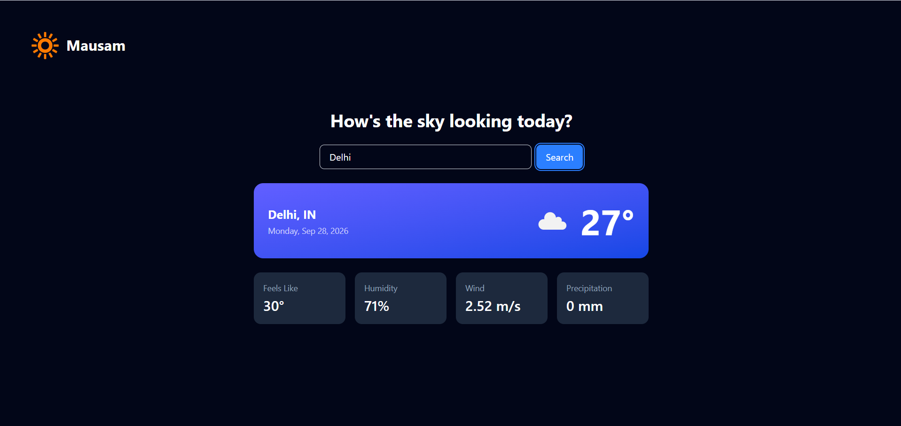

# Mausam



A responsive weather app built with React, Vite, and Tailwind CSS. Search for any city and see its current conditions, powered by the OpenWeatherMap API.

> **Status:** Phase 1 (MVP) complete. Forecasts, unit switching, and full responsive polish are in progress. See the [Roadmap](#roadmap).

## Features (v0.1.0)

- Search for weather by city name
- Current conditions: temperature, weather icon, description, location, and date
- Metric tiles: feels-like temperature, humidity, wind speed, precipitation
- Loading, error, and empty states
- Dark UI styled with Tailwind CSS

## Tech Stack

| Layer | Choice |
|---|---|
| UI | React |
| Build tool | Vite |
| Styling | Tailwind CSS |
| Data | OpenWeatherMap Current Weather API |

## Getting Started

### Prerequisites

- Node.js 18+
- A free [OpenWeatherMap API key](https://openweathermap.org/api) (new keys can take up to a couple of hours to activate)

### Installation

```bash
git clone https://github.com/akantdotgit/mausam.git
cd mausam
npm install
```

### Environment variables

Copy the example file and add your key:

```bash
cp .env.example .env
```

```
VITE_WEATHER_API_KEY=your_api_key_here
```

> `.env` is git-ignored. Note that any `VITE_` variable is bundled into client-side code, so treat this key as low-privilege. See [Architecture notes](#architecture-notes).

### Run locally

```bash
npm run dev
```

### Build for production

```bash
npm run build
npm run preview
```

## Project Structure

```
src/
├── components/
│   ├── SearchBar.jsx
│   ├── CurrentWeatherCard.jsx
│   └── MetricsGrid.jsx
├── hooks/
│   └── useWeather.js        # fetch state machine: idle | loading | success | error
├── services/
│   └── weatherApi.js        # all API calls + response normalization
├── App.jsx
├── index.css
└── main.jsx
```

## Architecture Notes

- **Service layer** (`services/weatherApi.js`): the only file that knows about the OpenWeatherMap URL and response shape. It returns a normalized object (`{ name, country, current: {...} }`), so the API provider can be swapped without touching any component.
- **Custom hook** (`hooks/useWeather.js`): owns fetch state as a single `status` value rather than separate booleans, which prevents impossible states (for example loading and error at once).
- **One-way data flow**: `App.jsx` reads from the hook and passes data down to presentational components as props.
- **Known limitation**: the API key is exposed in the client bundle. A planned improvement is a serverless proxy that keeps the key server-side.

## Roadmap

- [x] **Phase 1:** search + current weather + metric tiles
- [ ] **Phase 2:** 7-day forecast and hourly forecast with day selector
- [ ] **Phase 3:** Imperial/Metric unit toggle with dropdown
- [ ] **Phase 4:** responsive polish, hover/focus states, skeleton loading
- [ ] **Phase 5:** deployment (Vercel), serverless API proxy

## Changelog

See [CHANGELOG.md](./CHANGELOG.md).

## License

MIT