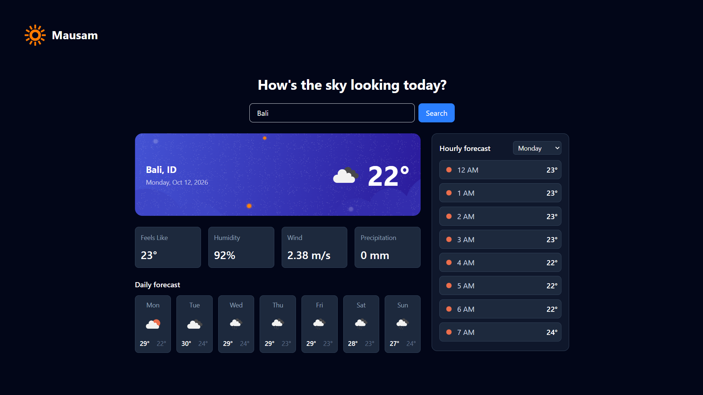

# Mausam



A responsive weather app built with React, Vite, and Tailwind CSS. Search for any city and see its current conditions and forecast.

> **Status:** Phase 2 complete — current weather plus 7-day and hourly forecasts. Unit switching and full responsive polish are in progress. See the [Roadmap](#roadmap).

## Features (v0.2.0)

- Search for weather by city name
- Current conditions: temperature, weather icon, description, location, and date
- Metric tiles: feels-like temperature, humidity, wind speed, precipitation
- 7-day daily forecast with icon and high/low temperature per day
- Hourly forecast with a day-selector dropdown
- Loading, error, and empty states
- Dark UI styled with Tailwind CSS

## Tech Stack

| Layer | Choice |
|---|---|
| UI | React |
| Build tool | Vite |
| Styling | Tailwind CSS |
| Current weather | OpenWeatherMap Current Weather API |
| Forecast data | Open-Meteo Forecast API |

## Getting Started

### Prerequisites

- Node.js 18+
- A free [OpenWeatherMap API key](https://openweathermap.org/api) (new keys can take up to a couple of hours to activate). Open-Meteo's forecast endpoint needs no key.

### Installation

```bash
git clone https://github.com/akantdotgit/mausam.git
cd mausam
npm install
```

### Environment variables

Copy the example file and add your key:

```bash
cp .env.example .env
```

```
VITE_WEATHER_API_KEY=your_api_key_here
```

> `.env` is git-ignored. Note that any `VITE_` variable is bundled into client-side code, so treat this key as low-privilege. See [Architecture notes](#architecture-notes).

### Run locally

```bash
npm run dev
```

## Project Structure

```
src/
├── components/
│   ├── CurrentWeatherCard.jsx
│   ├── DailyForecast.jsx
│   ├── HourlyForecast.jsx
│   ├── MetricsGrid.jsx
│   └── SearchBar.jsx
├── hooks/
│   └── useWeather.js        # fetch state machine: idle | loading | success | error
├── services/
│   └── weatherApi.js        # all API calls + response normalization
├── utils/
│   └── weatherCodeMap.js     # maps Open-Meteo WMO codes to OpenWeatherMap icons
├── App.jsx
├── index.css
└── main.jsx
```

## Architecture Notes

- **Service layer** (`services/weatherApi.js`): the only file that knows about the OpenWeatherMap and Open-Meteo URLs and response shapes. `fetchCurrentWeather` returns a normalized object (`{ name, country, lat, lon, current: {...} }`); `fetchForecast` returns `{ daily, hourly }`. Either provider can be swapped without touching any component.
- **Coordinate reuse**: `fetchCurrentWeather` returns `lat`/`lon` from OpenWeatherMap's response, which `fetchForecast` consumes directly. This avoids a second geocoding call when fetching the forecast.
- **Custom hook** (`hooks/useWeather.js`): owns fetch state as a single `status` value (`idle | loading | success | error`) covering both the current-weather and forecast requests together, rather than tracking them independently. This keeps impossible states (for example, current weather shown while forecast silently failed) from happening.
- **Icon consistency**: Open-Meteo returns WMO weather codes, not icons. `utils/weatherCodeMap.js` maps each WMO code to an OpenWeatherMap icon, so current-weather, daily, and hourly icons all share one visual style.
- **One-way data flow**: `App.jsx` reads from the hook and passes data down to presentational components as props.
- **Known limitation**: the OpenWeatherMap API key is exposed in the client bundle. A planned improvement is a serverless proxy that keeps the key server-side.

## Roadmap

- [x] **Phase 1:** search + current weather + metric tiles
- [x] **Phase 2:** 7-day forecast and hourly forecast with day selector
- [ ] **Phase 3:** Imperial/Metric unit toggle with dropdown
- [ ] **Phase 4:** responsive polish, hover/focus states, skeleton loading
- [ ] **Phase 5:** deployment (Vercel), serverless API proxy

## Changelog

See [CHANGELOG.md](./CHANGELOG.md).

## License

MIT